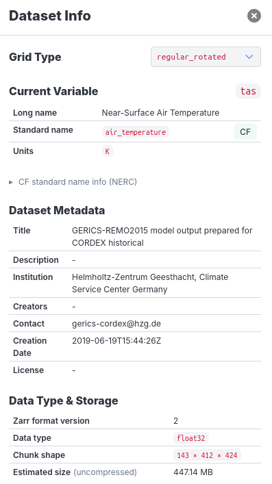
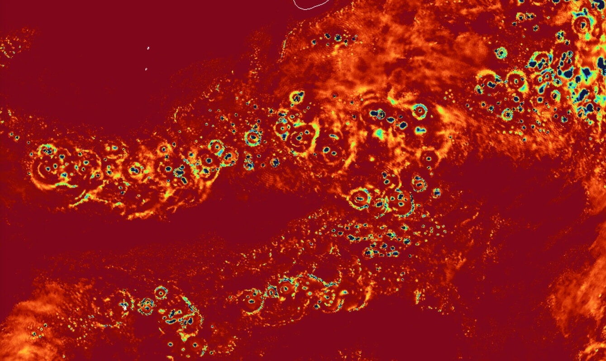
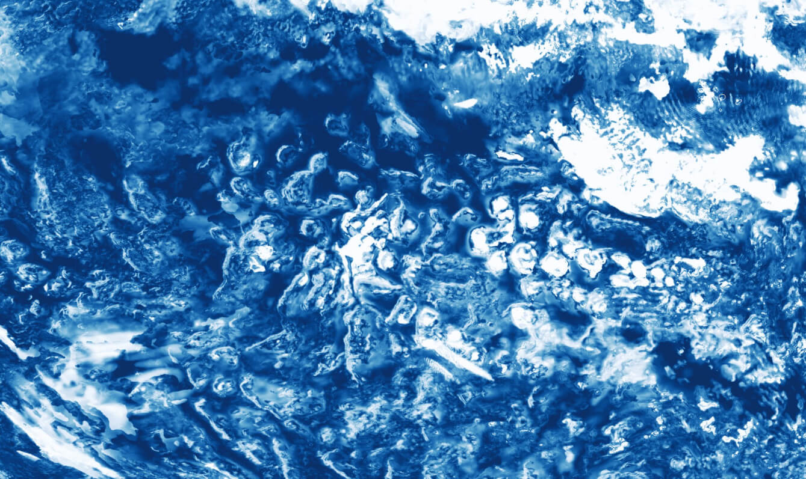

# Gridlook

Andrej Fast¹, Tobi Kölling², Fabian Wachsmann¹, and contributors

¹DKRZ, ²MPI-M

Gridlook is a browser-based WebGL viewer for interactive exploration of Earth
system model (ESM) output on native grids, read directly from cloud-hosted Zarr
stores, Icechunk repositories, Kerchunk reference files and NetCDF files.

- [Open Gridlook](https://gridlook.pages.dev/)
- [Read the EGU26 publication](https://www.egu26.eu/EGU26-9862.html)

## Documentation index

### Using Gridlook

- [Controls](Controls.md) — keyboard, mouse, touch, streamlines, and presenter
  controls.
- [Supported grid types](grid-types.md) — grid families, automatic detection,
  and alternative renderers.
- [URL parameters](url-parameters.md) — view settings stored in the URL.
- [JupyterLab / JupyterHub](../jupyter/README.md) — `pip install jupyter-gridlook`
  serves the viewer inside a Jupyter server, adds a **Gridlook** launcher card
  and an **Open with Gridlook** entry to the file browser's context menu (a
  consolidated zarr store under your home opens in a Lab tab, read with your
  session), and proxies allowlisted private S3, GCS and Azure stores through
  the hub's credentials.

### Providing data

- [Data sources](data-sources.md) — supported formats, forcing the data type,
  remote NetCDF requirements, and authentication.
- [Catalogs](catalogs.md) — catalog schema, hosting, and shareable catalog URLs.
- [Live-dataset server contract](live-datasets.md#server-contract) — endpoints
  required by live mode.
- [CORS and data hosting](../README.md#cors--hosting-notes) — browser access
  requirements and a header check.

## Capabilities

- Explore model output without installing desktop software, logging in to an
  HPC system, or generating map tiles first.
- Render regular and unstructured native grids without regridding, with
  automatic grid detection from dataset metadata.
- Read Zarr v2 and v3 stores, Icechunk repositories, Kerchunk reference files
  and NetCDF files directly in the browser and project, color, and render them
  with WebGL. Datasets behind authentication can be opened with a bearer
  token, custom headers or cookies.
- Use the 3D globe or one of several flat projections, scientific colormaps,
  histograms, range selection, auto-contrast, hover readout, a distance scale,
  and snapshot export.
- Add basemaps, coastlines, graticules, image layers, animated streamlines,
  and volume renderings of 3D variables.
- Share the dataset, variable, projection, and view parameters through a URL
  (remote datasets only; see [Open a dataset](#open-a-dataset)).
- Browse grouped datasets through catalogs or follow a running simulation in
  live mode.
- Present on a second screen with the Hyperglobe presenter mode (desktop only).
- Open a local Zarr store or a local NetCDF file directly from your file
  system, without uploading it anywhere.
- Use Gridlook inside JupyterLab and JupyterHub with `jupyter-gridlook`.

## Dataset information

- Open the **Dataset Info** panel to inspect the metadata of a dataset
- Review the current variable's long name, standard name, units, and CF
  standard-name information.
- Check standard name-details provided by [The NERC Vocabulary Server (NVS), National Oceanography Centre – BODC](https://vocab.nerc.ac.uk/)
- Inspect dataset metadata, available variables and dimensions, spatial
  coverage, data type, chunk shape, and estimated uncompressed size.



## Projections

- Nearside Perspective: the interactive 3D globe.
- Flat projections: Equirectangular, Mercator, Robinson, Mollweide, Cylindrical
  Equal Area, Azimuthal Equidistant, and Azimuthal Hybrid.
- Set the center of a projection by latitude and longitude.

## Layers

- Organize the data grid, basemaps, coastlines, graticules, streamlines,
  volumes, RGB composites, and custom image layers in one layer stack.
- Drag layers to change their drawing order, toggle their visibility, and
  adjust opacity where supported, including the data grid itself.
- **Maps and Masks:** show an OpenStreetMap, a simple vector map, or satellite
  imagery as basemap, limited to land or water if needed, with place labels on
  vector maps. Other basemaps can be provided through a basemap catalog, see
  the `basemapcatalog` [URL parameter](url-parameters.md).
- Choose 10m or 50m coastlines and 15° or 30° graticules.
- Import custom PNG, JPG, and GeoTIFF files as image layers, optionally cut
  out to land or sea.
- Create a GeoTIFF image layer from the currently loaded data, add it to the
  layer stack, and download it.
- Animate streamlines of a vector field, optionally on top of its magnitude;
  see the [controls guide](Controls.md#flow-streamlines).
- Render 3D variables as volumes on HEALPix, regular, rotated regular, and
  projected (e.g. Lambert, Mercator) grids.

## Open a dataset

- Start with the [hosted Gridlook application](https://gridlook.pages.dev/).
- Open a remote dataset directly with this URL pattern:

  ```text
  https://gridlook.pages.dev/#<DATASET_URL>
  ```

- Use a Zarr store, Icechunk repository, or NetCDF file that allows browser
  requests through CORS. The data type is detected automatically or can be
  forced with a prefix like `icechunk+https://` or `netcdf+https://`; see
  [Data sources](data-sources.md).
- Open a [Kerchunk reference file](https://fsspec.github.io/kerchunk/spec.html)
  (JSON, version 0 or 1) with `reference+https://<file>.json`, followed by the
  path of a group if needed. The whole file is loaded when the dataset is
  opened, so keep it to a few hundred thousand references.
- Send a bearer token, custom headers, or cookies through the advanced
  settings of the "Open dataset" dialog; see
  [Authentication](data-sources.md#authentication).
- Open multiple related datasets through a [Gridlook catalog](catalogs.md).
- Follow a changing dataset by adding `::live=true`; see
  [Live datasets](live-datasets.md).
- Store view settings like variable, colormap or time step in the URL; see
  [URL parameters](url-parameters.md).
- Use the [controls guide](Controls.md) for keyboard, mouse, touch, streamline,
  and presenter controls.

### Local Zarr and NetCDF files

- In the "Open" tab of the "Open dataset" dialog, use **Local Zarr** to
  select a local Zarr dataset directory, or **Local NetCDF** to select a local
  `.nc`/`.nc4`/`.cdf` file. Both are read directly in the browser; nothing is
  uploaded to a server.
- Only one local dataset can be open at a time — opening another local file
  or directory replaces the previous one.
- **Local datasets cannot be shared or restored through a URL.** Gridlook's
  URL only records a reference to the selected file, not its content, so
  reloading the page, following a shared link, or using the share/QR-code
  feature will not reopen a local dataset — you must re-select the file or
  directory each time. URL-based sharing works only for remote datasets.

## Supported grids

- Regular latitude-longitude grids, including Web Mercator and zonal means.
- Rotated regular latitude-longitude grids, including CORDEX output.
- Curvilinear grids, including ocean-model grids.
- Reduced Gaussian grids, including IFS-style products.
- HEALPix grids, including ICON and HEALPix-remapped output.
- Triangular grids, including native ICON output and UGRID meshes.
- Irregular and unstructured grids, including AWI-CM and FESOM output.

See [Supported grid types](grid-types.md) for detection rules and rendering
alternatives.

## Examples

- [Triangular: EERIE ICON historical near-surface temperature on R2B8](https://gridlook.pages.dev/#https://gridlook.pages.dev/static/index_mr_dpp0066.json::varname=sfcwind::dimIndices_time=1)
- [Regular: CMIP6 EC-Earth3P-HR precipitation](https://gridlook.pages.dev/#https://storage.googleapis.com/cmip6/CMIP6/HighResMIP/EC-Earth-Consortium/EC-Earth3P-HR/highresSST-present/r1i1p1f1/Amon/pr/gr/v20170811/)
- [Rotated regular: EURO-CORDEX REMO2015 near-surface temperature](https://gridlook.pages.dev/#https://euro-cordex.s3.amazonaws.com/CMIP5/cordex/output/EUR-11/GERICS/MPI-M-MPI-ESM-LR/historical/r3i1p1/REMO2015/v1/mon/tas/v20190925/)
- [Reduced Gaussian: EERIE IFS historical output on TCO1279](https://gridlook.pages.dev/#https://eerie.cloud.dkrz.de/datasets/ifs-amip-tco1279.hist.v20240901.atmos.native.2D_monthly/stac)
- [Healpix](https://gridlook.pages.dev/#https://s3.waterpark.dkrz.de/eerie/eerie-future-ssp245-v20240618_P1M_mean_7.zarr)
- [Irregular: CMIP6 AWI-CM historical sea-surface temperature](https://gridlook.pages.dev/#https://cmip6-pds.s3.amazonaws.com/CMIP6/CMIP/AWI/AWI-CM-1-1-MR/historical/r1i1p1f1/Oday/tos/gn/v20181218/)

## Use cases

- Embed interactive model views in web applications, including mobile layouts.
- Understand model internals, such as ring-shaped precipitation in IFS
- Find bugs and diagnose model output, such as the
  [Amazon River temperature anomaly in CMIP6 MPI-ESM1-2](https://gridlook.pages.dev/#https://storage.googleapis.com/cmip6/CMIP6/ScenarioMIP/DKRZ/MPI-ESM1-2-HR/ssp370/r1i1p1f1/Amon/tas/gn/v20190710/).

| IFS DYAMOND3 precipitation over the Indian Ocean                                              | IFS DYAMOND3 cloud cover over the Pacific                                  |
| --------------------------------------------------------------------------------------------- | -------------------------------------------------------------------------- |
|  |  |

## Technology

- TypeScript and Vue.js for the application.
- Bulma for the interface.
- Three.js and WebGL for rendering.
- Zarrita for Zarr dataset access, `icechunk-js` for Icechunk repository
  access, and `netcdf4-wasm` for NetCDF files.

## Publication

- [Gridlook: Interactive Visualization of Cloud-Hosted Earth System Model
  Output on Native Grids — EGU26-9862](https://www.egu26.eu/EGU26-9862.html)
